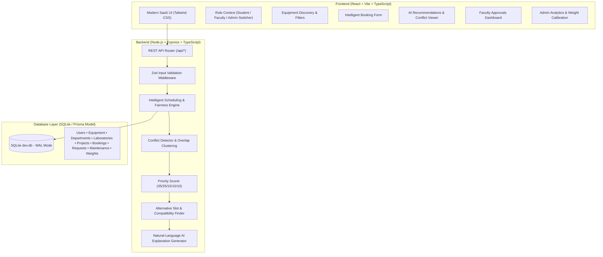

# LabLink — Making College Laboratories More Accessible

[](https://github.com)
[](https://github.com)
[](https://www.typescriptlang.org/)
[](LICENSE)

> **Important Notice:** This version of LabLink is an open-access academic demonstration platform using fictional data. It intentionally does not implement authentication barriers (passwords, logins, signups, OTPs, or JWTs) so evaluators can instantly access and test all student, faculty, and administrative workflows. The demonstration role selector only changes the displayed interface and does not provide actual server-side security authorization. Do not use real institutional or personal data without implementing proper authentication and authorization controls.

---

## 1. Project Overview & Problem Statement

### The Problem
In modern universities, students frequently struggle to access specialized laboratory equipment, edge computing rigs, and prototyping stations because:
- **Departmental Silos:** Equipment availability in ECE, EEE, Robotics, or Mechanical labs is invisible to CSE and interdisciplinary students.
- **Resource Underutilization:** Expensive workstations (FPGAs, GPUs, Oscilloscopes) sit idle during off-peak hours while bottlenecked during milestone weeks.
- **Manual Contention:** Students request the exact same slots and competing requests are reviewed arbitrarily on a first-come, first-served basis without evaluating urgency or past resource consumption.
- **No Conflict Detection:** Overlapping booking requests lead to confusion, double bookings, and frustration.

### The Solution
**LabLink** is a centralized, GenAI-assisted campus laboratory resource-sharing platform. It unifies cross-department equipment discovery, live availability tracking, project-based access, and transparent faculty approval workflows.

At its core is a **deterministic, weighted intelligent scheduling engine** that detects conflicting requests, scores them transparently based on deadline urgency, technical fit, and historical fairness, and recommends optimal allocations alongside verified alternative time slots and compatible equipment.

---

## 2. Key Platform Capabilities

1. **Cross-Department Equipment Discovery:** Browse 12+ seeded instrumentation categories across CSE, ECE, EEE, Mechanical, and Robotics labs with real-time slot tracking.
2. **Deterministic Intelligent Scheduling Engine:** Automatically clusters overlapping requests and evaluates a 5-factor weighted priority score without requiring external paid API keys.
3. **Anti-Monopolization & Historical Fairness:** Systematically prioritizes first-time and under-allocated students over repeat power users.
4. **Verified Alternative Recommendations:** Proposes same-day, next-day, and compatible cross-department hardware alternatives verified against live calendar reservations.
5. **Faculty Authorization Workflow:** Lab heads inspect student project justifications and AI score breakdowns to approve or reject requests with immediate database updates.
6. **Live Institutional Analytics:** Dynamic administrator dashboard calculating campus equipment utilization percentage, department velocity, and peak booking hours directly from database records.
7. **Administrative Asset & Maintenance Controls:** Add/edit/remove instruments, manage lab locations, schedule maintenance lockouts, and tune algorithm weights via interactive sliders.

---

## 3. Technology Stack

- **Frontend:** React 18, Vite, TypeScript (Strict), Tailwind CSS, Lucide React icons, React Router v6.
- **Backend:** Node.js 24, Express.js, TypeScript (Strict), Zod schema validation, RESTful APIs.
- **Database & ORM:** SQLite with high-performance native `node:sqlite` (DatabaseSync, WAL mode) and migration-friendly Prisma schema architecture.
- **AI & Scheduling:** Custom deterministic multi-criteria constraint engine with transparent weighted priority scoring and natural-language rationale generation.
- **Testing:** Vitest, React Testing Library, Supertest (27 automated tests passing).
- **Asset Footprint:** Ultra-lightweight SVG illustrations and CSS styling keeping the tracked repository footprint below **0.63 MB** (strict limit: < 10 MB).

---

## 4. System Architecture



---

## 5. Folder Structure

```
lablink/
├── backend/
│   ├── prisma/
│   │   └── schema.prisma         # Declarative schema for PostgreSQL / Prisma compatibility
│   ├── src/
│   │   ├── controllers/          # Request handlers
│   │   ├── db/
│   │   │   ├── database.ts       # Native node:sqlite client with WAL mode
│   │   │   ├── schema.sql        # Normalized DDL table definitions & indexes
│   │   │   └── seed.ts           # Realistic campus seed data script
│   │   ├── middleware/
│   │   │   └── errorHandler.ts   # Centralized Zod & HTTP error handler
│   │   ├── routes/               # Modular Express API endpoints
│   │   ├── scheduling/
│   │   │   ├── alternativeFinder.ts    # Live alternative slot & compatibility search
│   │   │   ├── conflictDetector.ts     # Overlap clustering & maintenance lockouts
│   │   │   ├── explanationGenerator.ts # Natural-language AI rationale generator
│   │   │   ├── fairAllocator.ts        # Cluster resolution orchestrator
│   │   │   ├── priorityScorer.ts       # 5-factor weighted formula implementation
│   │   │   └── types.ts
│   │   ├── services/             # Database repository services
│   │   ├── types/
│   │   ├── validators/           # Zod schema contracts
│   │   ├── app.ts                # Express application configuration
│   │   └── index.ts              # Server bootstrap entry point
│   ├── tests/
│   │   ├── api.test.ts           # REST API endpoint integration tests
│   │   ├── scenario.test.ts      # 20-step end-to-end scenario integration test
│   │   └── scheduling.test.ts    # Scheduling engine unit tests
│   ├── package.json
│   ├── tsconfig.json
│   └── vitest.config.ts
├── frontend/
│   ├── src/
│   │   ├── components/           # Reusable UI components (Navbar, StatusBadge, Modal, etc.)
│   │   ├── context/              # RoleContext & NotificationContext
│   │   ├── pages/                # 15 distinct pages for Student, Faculty, and Admin
│   │   ├── services/
│   │   │   └── api.ts            # Client API abstraction
│   │   ├── test/                 # React Testing Library automated tests
│   │   ├── types/
│   │   ├── App.tsx               # Master router & view orchestration
│   │   ├── index.css             # Tailwind base & custom design tokens
│   │   └── main.tsx
│   ├── index.html
│   ├── package.json
│   ├── tailwind.config.js
│   ├── tsconfig.json
│   └── vite.config.ts
├── scripts/
│   └── check-repo-size.js        # Repository size verification script
├── .env.example
├── .gitignore
├── package.json
└── README.md
```

---

## 6. The Intelligent Scheduling Algorithm

When competing requests overlap for the same equipment and calendar date, LabLink's scheduling engine computes a transparent, composite priority score normalized to a scale of 0 to 100:

$$\text{Composite Score} = (U \times W_{\text{deadline}}) + (C \times W_{\text{compat}}) + (Q \times W_{\text{wait}}) + (F \times W_{\text{fair}}) + (S \times W_{\text{feas}})$$

### Initial Weight Distribution (Admin-Configurable):

| Parameter | Default Weight | Description & Calculation Metric |
|---|---:|---|
| **Project Deadline Urgency ($U$)** | **35%** | Evaluates days remaining until milestone submission: $\le 1$ day: 98–100, $\le 3$ days: 90, $\le 7$ days: 78, $\le 14$ days: 60, $\le 30$ days: 30. |
| **Technical Requirement & Compatibility ($C$)** | **25%** | Cross-correlates project descriptions, technical requirements, and equipment specifications (e.g., Vivado synthesis on FPGA, CUDA on Jetson). |
| **Queue Waiting Time ($Q$)** | **15%** | Rewards requests queued in advance ($>48\text{h}$: 100, $>24\text{h}$: 85, $>12\text{h}$: 70, $>4\text{h}$: 50). |
| **Historical Allocation Fairness ($F$)** | **15%** | Anti-monopolization metric: 0 prior approved bookings: 100, 1 prior: 85, 2 prior: 70, 3 prior: 55, 4+ prior: 40. |
| **Scheduling Feasibility ($S$)** | **10%** | Evaluates duration fit within lab operating hours (08:00–18:00) and adherence to hardware duration caps. |

Total: **100% (1.0)**. Administrators can dynamically fine-tune these coefficients via the Settings page.

---

## 7. The 20-Step End-to-End Demonstration Scenario

The platform supports the complete master prompt workflow:

1. **Step 1:** Open application in browser — loads immediately without login or password barriers.
2. **Step 2:** Select the **Student** role from the header dropdown.
3. **Step 3:** Search for `"FPGA Development Kit"` in the catalog.
4. **Step 4:** Open equipment details and review Artix-7 specifications and active calendar availability.
5. **Step 5:** Create an academic project titled *"Real-Time Image Processing System"* with a 3-day deadline.
6. **Step 6:** Submit an access request for tomorrow (10:00 - 13:00).
7. **Step 7:** Switch student profile to **Priya Patel** and submit an overlapping request for tomorrow (11:00 - 14:00).
8. **Step 8:** Application detects the conflict automatically.
9. **Step 9:** Intelligent scheduling engine clusters both requests.
10. **Step 10:** Priority scores are calculated (Aarav receives higher score due to imminent deadline and first-time usage).
11. **Step 11:** Engine recommends Aarav as the primary allocation.
12. **Step 12:** Engine generates verified alternative time slots (same-day afternoon slot, next-day slot, or Jetson Nano alternative) for Priya.
13. **Step 13:** Switch to **Faculty** role (**Prof. Ananya Iyer**).
14. **Step 14:** Open the Pending Requests interface.
15. **Step 15:** Inspect competing project scopes, deadline urgency, and AI rationale.
16. **Step 16:** Approve the recommended allocation — slot availability updates immediately in the database.
17. **Step 17:** Switch back to **Student** role.
18. **Step 18:** Aarav views his status as `Approved`; Priya views her status as `Alternative Suggested` with viable slots.
19. **Step 19:** Switch to **Administrator** role.
20. **Step 20:** View updated campus utilization percentage, active booking count, conflict logs, and audit records.

---

## 8. Installation & Setup Instructions

### Prerequisites
- Node.js version 20+ (Node.js 22 or 24 recommended).
- npm version 9+.

### 1. Clone & Install Dependencies
```bash
# Clone the repository
git clone <repository-url>
cd unreal_prompt

# Install backend dependencies
cd backend
npm install

# Install frontend dependencies
cd ../frontend
npm install

# Return to root directory
cd ..
```

### 2. Configure Environment Variables
Copy `.env.example` to `backend/.env`:
```bash
cp .env.example backend/.env
```

### 3. Initialize & Seed Database
```bash
cd backend
npm run seed
cd ..
```

---

## 9. Running the Application Locally

Run backend and frontend concurrently from root:

```bash
# Terminal 1: Start Backend API (Port 5000)
cd backend
npm run dev

# Terminal 2: Start Frontend Development Server (Port 5173)
cd frontend
npm run dev
```

Open your browser and navigate to:
**`http://localhost:5173`**

The application will immediately render the LabLink interface without requiring any login credentials.

---

## 10. Automated Testing

Run the full automated test suite (backend unit tests, 20-step scenario integration tests, and frontend React tests):

```bash
# Run all tests across backend and frontend
npm test

# Run backend & scenario tests only
cd backend
npm test

# Run frontend unit tests only
cd frontend
npm test
```

### Test Suite Summary:
- **Backend Scheduling Tests:** 8 tests passing (Urgency scoring, compatibility matching, fairness bonuses, feasibility penalties, overlap detection, maintenance lockouts).
- **Backend API Integration Tests:** 7 tests passing (Catalog discovery, search filters, details, live analytics calculations, booking creation, faculty approval workflows).
- **Master Scenario Integration Tests:** 8 tests passing (Complete 20-step competing FPGA access scenario with live database state transitions).
- **Frontend Component & Role Tests:** 4 tests passing (Instant role switching, status badges, direct access without login/password barriers).
- **Total: 27 automated tests passing.**

---

## 11. Production Build & Repository Size Verification

### Build for Production:
```bash
# Build backend
cd backend
npm run build

# Build frontend
cd ../frontend
npm run build

cd ..
```

### Measure Repository Size:
Verify that the project source code remains strictly within the 10 MB limit:

```bash
npm run check-size
```

**Measured Size:** **`~0.626 MB`** (well below the 8 MB safety threshold).

---

## 12. API Endpoint Overview

| Method | Endpoint | Description |
|---|---|---|
| `GET` | `/api/health` | Service health status and open-access mode confirmation |
| `GET` | `/api/equipment` | Search and filter laboratory catalog across all departments |
| `GET` | `/api/equipment/:id` | Full equipment specifications, location, and calendar availability |
| `POST` | `/api/equipment` | (Admin) Register new laboratory equipment |
| `PUT` | `/api/equipment/:id` | (Admin) Update equipment specifications and duration caps |
| `DELETE` | `/api/equipment/:id` | (Admin) Delete equipment record |
| `GET` | `/api/projects` | List academic projects for a student |
| `POST` | `/api/projects` | Register a new research project |
| `POST` | `/api/bookings/request` | Submit a project-based booking request |
| `GET` | `/api/bookings/requests` | List booking requests by student, equipment, or status |
| `POST` | `/api/bookings/requests/:id/cancel` | Cancel an eligible booking request |
| `GET` | `/api/scheduling/recommendations` | List active AI conflict resolution recommendations |
| `GET` | `/api/scheduling/recommendations/:groupId` | Retrieve detailed recommendation and alternatives for a conflict group |
| `GET` | `/api/scheduling/weights` | Retrieve active algorithm priority coefficients |
| `PUT` | `/api/scheduling/weights` | (Admin) Update algorithm priority coefficients (must sum to 1.0) |
| `GET` | `/api/faculty/requests` | List pending requests requiring faculty decisions |
| `POST` | `/api/faculty/requests/:id/decision` | Record faculty approval or rejection with live calendar updates |
| `GET` | `/api/admin/analytics` | Dynamic utilization stats, department metrics, and peak hours |
| `GET` | `/api/admin/audit-logs` | Immutable audit log of administrative and faculty actions |
| `GET` | `/api/admin/maintenance` | List active and scheduled maintenance lockouts |
| `POST` | `/api/admin/maintenance` | Schedule equipment maintenance and lockout dates |
| `GET` | `/api/notifications` | List database-backed notifications for the active user |
| `GET` | `/api/users` | List demonstration accounts categorized by role |

---

## 13. Security Considerations & Production Roadmap

- **Demonstration Scope:** The role selector (`Student`, `Faculty`, `Administrator`) is built strictly for evaluation navigation and demonstration convenience.
- **Production Transition:** Before connecting real institutional student records or laboratory equipment to this platform:
  1. Integrate institutional SSO (SAML 2.0 / OAuth2 / OpenID Connect / Shibboleth).
  2. Implement server-side JWT verification and session-based role-based access control (RBAC) middleware on administrative and faculty endpoints.
  3. Migrate SQLite datasource to managed PostgreSQL (`schema.prisma` is pre-configured and fully compatible).
  4. Enable TLS certificate pinning and strict origin CORS headers.

---

## 14. License

This project is licensed under the MIT License.
